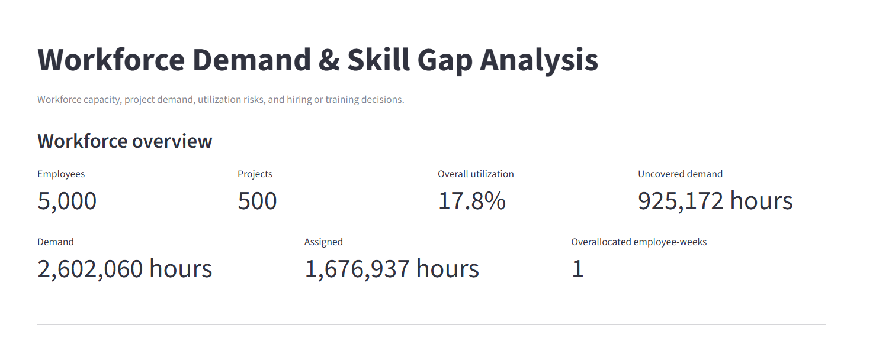
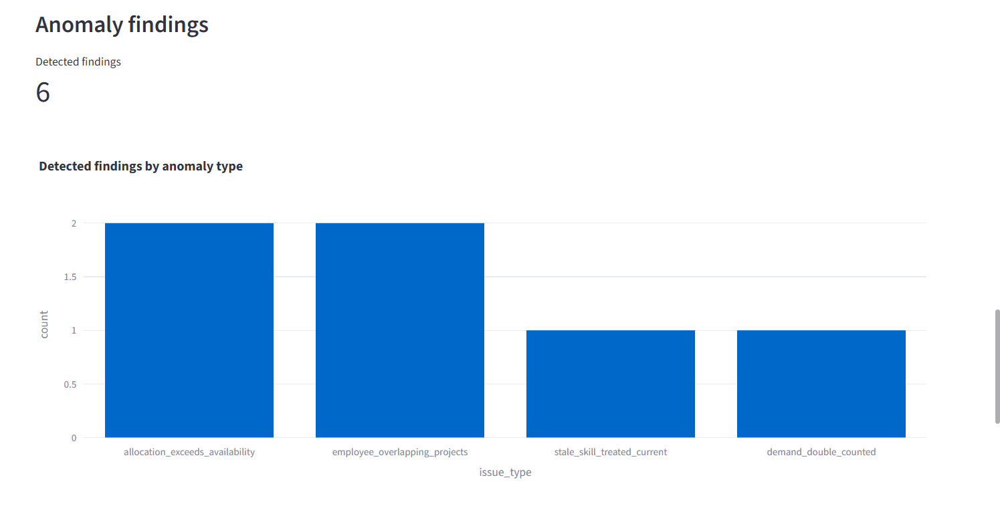

\# Workforce Demand Forecasting and Skill Gap Analysis


\## Overview


A Python-based workforce planning system that analyzes project demand, employee availability, workforce utilization, skill gaps, and data-quality anomalies. It uses reproducible synthetic data and provides CSV outputs and an interactive Streamlit dashboard.


\## Live Demo

**Try the application:** [Open Workforce Planning Dashboard](https://workforceplanningsystem-v8rpg54lqpfnkhytplrjff.streamlit.app)

Explore workforce utilization, demand forecasting, skill gaps, anomaly detection, and downloadable reports.


\## Dataset


\- 5,000 employees

\- 10 roles

\- 300 skills

\- 500 projects

\- 52 weekly periods

\- 260,000 employee-week availability records


\## Features


\- Synthetic workforce data generation

\- Employee availability and project allocation

\- Workforce utilization analysis

\- Demand-gap analysis

\- Detection of allocation capacity violations

\- Detection of stale skills marked as current

\- Detection of duplicate demand

\- Detection of employees allocated to multiple projects

\- Separate ground-truth labels for anomaly testing

\- Streamlit dashboard

\- Automated tests with pytest


\## Technology Stack


Python, Pandas, NumPy, Faker, Streamlit, Plotly, and pytest.


\## Project Structure


```text

Workforce_Planning_System/

├── dashboard/

│   └── app.py

├── data/

│   ├── raw/

│   ├── processed/

│   └── ground_truth/

├── src/

│   ├── generate_data.py

│   ├── generate_transactions.py

│   ├── business_logic.py

│   ├── inject_anomalies.py

│   └── validate_data.py

├── tests/

│   └── test_system.py

├── .gitignore

├── requirements.txt

└── README.md

```


\## Installation


Run these commands in PowerShell from the project root:


```powershell

python -m venv .venv

.\\.venv\\Scripts\\Activate.ps1

pip install -r requirements.txt

```


\## Run the Project


Run each command in order:


1\. Generate master data:


&#x20;  `python src/generate\_data.py --full`


2\. Generate transaction data:


&#x20;  `python src/generate\_transactions.py`


3\. Inject the four test anomalies:


&#x20;  `python src/inject\_anomalies.py`


4\. Calculate workforce metrics:


&#x20;  `python src/business\_logic.py`


5\. Validate anomalies:


&#x20;  `python src/validate\_data.py`


6\. Run tests:


&#x20;  `python -m pytest tests -v`


Run anomaly injection only once per freshly generated dataset.

## Reproducibility and Validation

- **Deterministic data generation:** Verified that master and transaction CSV files generated using the same seed and configuration are identical across two independent runs.

- **Anomaly detection reproducibility:** SHA-256 comparisons confirmed that `anomaly_findings.csv` and `ground_truth_evaluation.csv` are identical across repeated validation runs.

- **Ground-truth evaluation:** All 4 labelled anomalies in the test dataset were detected (4/4).

- **Detected findings:** 6 findings across four anomaly categories: over-capacity allocations, overlapping project assignments, stale skills marked as current, and duplicate demand.

- **Test isolation:** Reproducibility checks were performed in a separate test directory to avoid intentionally overwriting the original working dataset.

These results apply to the tested dataset, configuration, and execution environment.


\## Launch the Dashboard


```powershell

python -m streamlit run dashboard/app.py

```


Open the local URL printed by Streamlit, usually http://localhost:8501.


\## Output Files


\- `data/raw/`: master and transaction CSV files

\- `data/processed/utilization.csv`: workforce utilization metrics

\- `data/processed/GapAnalysis.csv`: demand-gap analysis

\- `data/processed/anomaly\_findings.csv`: detected anomalies

\- `data/processed/ground\_truth\_evaluation.csv`: evaluation against labelled cases

\- `data/ground\_truth/ground\_truth.csv`: separate anomaly labels


\## Reproducibility


The data generators use the fixed seed `20261022`.


\## Current Test Status


The latest recorded test run passed six automated tests. The validator detected all four labelled anomaly scenarios in the full dataset. Re-run the tests after making code changes.


\## Limitations


\- The dataset is synthetic.

\- The current time granularity is weekly.

\- Anomaly evaluation should be extended with precision, recall, and false-positive metrics.

\- Hiring and training recommendations require further validation before production use.


\## Future Improvements


\- Improve demand forecasting using time-series models.

\- Add skill-based employee matching and hiring recommendations.

\- Improve anomaly evaluation metrics.

\- Add SQL-backed storage and export support.

\- Expand automated tests for edge cases.


## Dashboard Screenshots

### 1. Workforce Overview



### 2. Anomaly Detection Results

